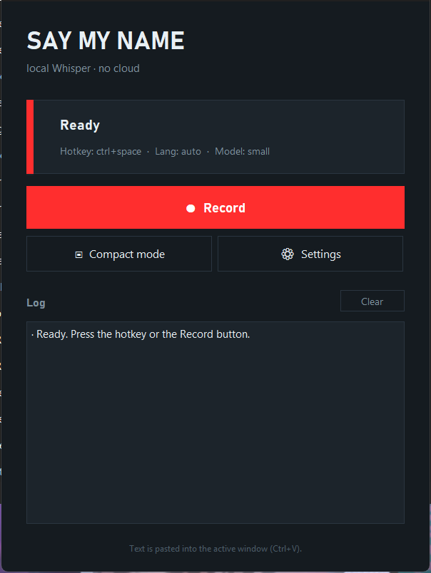
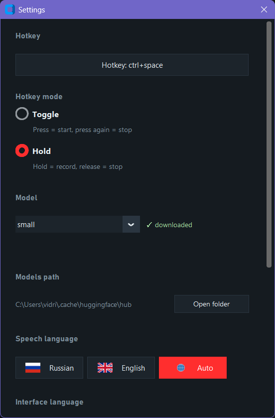
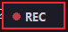

# SAY MY NAME

**Languages:** 🇬🇧 [English](README.md) · 🇷🇺 [Русский](README.ru.md)

Local voice dictation for the any text field. Hold (or tap) a hotkey, speak, release — your words appear where the cursor is. Powered by [faster-whisper](https://github.com/SYSTRAN/faster-whisper) on your own machine: no cloud, no tokens, no account.

---

## Screenshots

### Main window



### Settings



### Compact REC indicator



---

## How it works

1. **Record** — global hotkey starts microphone capture (`sounddevice`, 16 kHz).
2. **Stop** — second press (Toggle) or key release (Hold / push-to-talk).
3. **Transcribe** — `faster-whisper` runs locally (CPU or CUDA if available).
4. **Paste** — text is copied to the clipboard and sent as `Ctrl+V` into the focused window.

You always see the transcript in the app log before it is pasted

---

## Requirements

- Windows 10/11
- Python 3.10+
- Microphone
- Optional NVIDIA GPU (CUDA) for faster transcription

Python packages (see [`app/requirements.txt`](app/requirements.txt)):

`customtkinter`, `faster-whisper`, `sounddevice`, `keyboard`, `pyperclip`, `Pillow`, `numpy`, `requests`

---

## Install and run

### 1. First run

Double-click **`start.bat`**. It will:
- check required files
- create `venv` and install packages
- create **`SAY MY NAME.lnk`** in the app folder and on the desktop (only if missing)
- start the app

### 2. Later

Use the **desktop shortcut** or **`SAY MY NAME.lnk`** (silent, no console).
`start.vbs` goes through `start.bat`, so packages are checked on every launch.

### 3. From a terminal

```bat
run_ui_debug.bat
```

Console is useful if something fails.

### 4. Requirements

- Python 3.10+ with **pip** enabled (installer: *Add python.exe to PATH*)
- `pip install -r app\requirements.txt` if you manage packages yourself

Whisper model weights download automatically on first use into the Hugging Face cache (`~/.cache/huggingface`).

---

## Usage

| Action                 | How                                                                      |
| ---------------------- | ------------------------------------------------------------------------ |
| Start / stop recording | Global hotkey (default `Ctrl+Space`, changeable)                         |
| Compact REC widget     | **Compact** button — click = record, double-click = expand, drag to move |
| Right-click compact    | Open main window, Settings, Exit                                         |
| Text                   | Pasted into the active window via clipboard (`Ctrl+V`)                   |

### Hotkey modes

| Mode                    | Behaviour                               |
| ----------------------- | --------------------------------------- |
| **Toggle** (default)    | Press to start, press again to stop     |
| **Hold** (push-to-talk) | Hold the combo = record, release = stop |

Hold applies to the **global hotkey only**. Buttons and the compact widget always toggle.

---

## Settings

| Setting               | Meaning                                                              |
| --------------------- | -------------------------------------------------------------------- |
| Hotkey                | Capture any combo (click the field, press keys)                      |
| Hotkey mode           | Toggle or Hold                                                       |
| Model                 | `tiny` / `base` / `small` / `medium` / `large-v3` / `large-v3-turbo` |
| Download              | Shown only if the model is not on disk yet                           |
| Models path           | Open the Hugging Face cache folder                                   |
| Speech language       | 🇷🇺 Russian · 🇬🇧 English · 🌐 Auto                                |
| Interface language    | Русский / English                                                    |
| Always on top         | Main window stays above other apps                                   |
| Start in compact mode | Launch into the REC widget (no main window)                          |
| Max record (sec)      | Auto-stop after N seconds                                            |

Settings are saved in [`app/config.json`](app/config.json) (not in git).

---

## Project files

| Path                   | Purpose                                             |
| ---------------------- | --------------------------------------------------- |
| `start.bat`            | First run: find Python, create `venv`, install deps |
| `SAY MY NAME.lnk`      | Silent launcher (created on first `start.bat` / update) |
| `start.vbs`            | Silent start via `start.bat` (checks deps every launch) |
| `run_ui.bat`           | Forwards to `start.vbs`                             |
| `run_ui_debug.bat`     | Starts with a console for debugging                 |
| `make_lnk.ps1`         | Rebuilds the shortcut if the project moves          |
| `LICENSE`              | CC BY-NC-ND 4.0                                     |
| `app/asr_ui.py`        | Main UI and audio pipeline                          |
| `app/i18n.py`          | Interface strings (en / ru)                         |
| `app/model_manager.py` | Whisper model download & status                     |
| `app/svg_flags.py`     | SVG → image for language flags                      |
| `app/config.json`      | Saved settings (gitignored)                         |
| `app/assets/flags/`    | Flag SVGs for the language picker                   |
| `img/`                 | README screenshots                                  |

---

## UI languages

English and Russian. The interface language is independent of the **speech** language (what Whisper listens for).

Flags are SVG (`app/assets/flags/`), rasterised at runtime — no emoji fonts required.

---

## Models

| Size                          | Quality                      | Speed (CPU)        |
| ----------------------------- | ---------------------------- | ------------------ |
| `tiny` / `base`               | Rough notes                  | Very fast          |
| `small`                       | Good for dictation (default) | Fast               |
| `medium`                      | Better accuracy              | Slower             |
| `large-v3` / `large-v3-turbo` | Best                         | Slowest / balanced |

Russian works well from `small` upward. `large-v3-turbo` is the best speed/quality trade-off if your machine can load it.

---

## Limitations

- Paste uses `Ctrl+V` — apps that ignore clipboard paste will not receive text.
- Hold mode is global; if another tool swallows the same combo, change the hotkey.
- Whisper is not a keyword assistant — it transcribes; it does not execute commands.
- Windows only is the supported target (Mac/Linux: the Python app mostly works, launchers do not).

---

## License

Creative Commons Attribution-NonCommercial-NoDerivatives 4.0 (CC BY-NC-ND 4.0).

See [LICENSE](LICENSE) for details.
