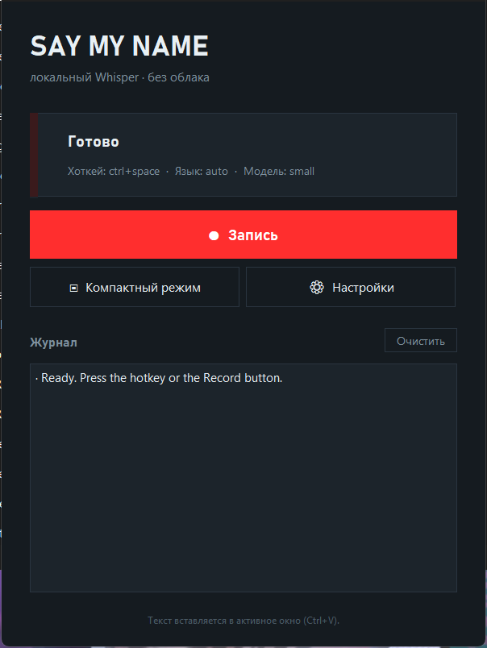
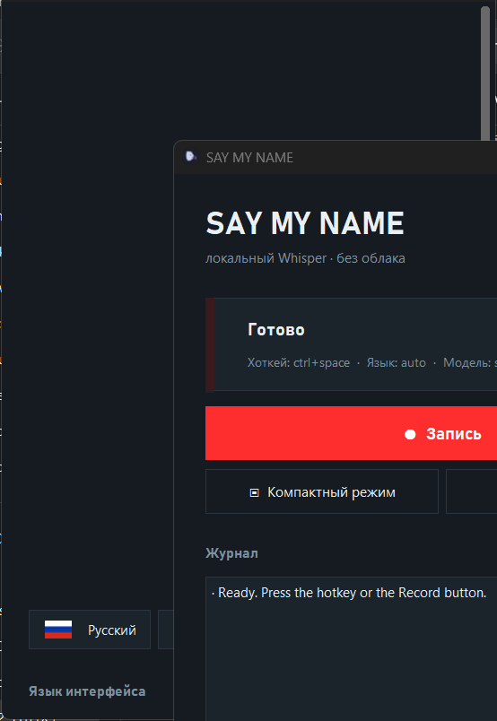
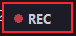

# SAY MY NAME

**Languages:** 🇬🇧 [English](README.md) · 🇷🇺 [Русский](README.ru.md)

Локальная голосовая диктовка для любых полей ввода. Удерживайте (или нажмите) хоткей, говорите, отпустите — слова появятся там, где стоит курсор. Работает на [faster-whisper](https://github.com/SYSTRAN/faster-whisper) на вашем компьютере: без облака, без токенов, без аккаунта.

---

## Скриншоты

### Главное окно



### Настройки



### Компактный индикатор REC



---

## Видео

[](https://www.youtube.com/shorts/ww-oOtd7inU)

---

## Как это работает

1. **Запись** — глобальный хоткей включает микрофон (`sounddevice`, 16 кГц).
2. **Стоп** — повторное нажатие (Toggle) или отпускание клавиши (Hold / push-to-talk).
3. **Распознавание** — `faster-whisper` локально (CPU или CUDA, если есть).
4. **Вставка** — текст копируется в буфер и отправляется как `Ctrl+V` в активное окно.

Распознанный текст вы видите в журнале **до** вставки 

---

## Требования

- Windows 10/11
- Python 3.10+
- Микрофон
- Необязательно: NVIDIA GPU (CUDA) для ускорения

Пакеты Python (см. [`app/requirements.txt`](app/requirements.txt)):

`customtkinter`, `faster-whisper`, `sounddevice`, `keyboard`, `pyperclip`, `Pillow`, `numpy`, `requests`

---

## Установка и запуск

### 1. Первый запуск

Двойной клик по **`start.bat`**. Он:
- проверит нужные файлы
- создаст `venv` и установит пакеты
- создаст **`SAY MY NAME.lnk`** в папке и на рабочем столе (только если ярлыка ещё нет)
- запустит приложение

### 2. Дальше

Используйте **ярлык на рабочем столе** или **`SAY MY NAME.lnk`** (тихо, без консоли).
`start.vbs` идёт через `start.bat`, поэтому пакеты проверяются при каждом запуске.

### 3. Из терминала

```bat
run_ui_debug.bat
```

С консолью удобно, если что-то не запускается.

### 4. Требования

- Python 3.10+ с **pip** (установщик: *Add python.exe to PATH*)
- Или вручную: `pip install -r app\requirements.txt`

Веса Whisper качаются автоматически при первом использовании в кэш Hugging Face (`~/.cache/huggingface`).

---

## Использование

| Действие            | Как                                                                          |
| ------------------- | ---------------------------------------------------------------------------- |
| Старт / стоп записи | Глобальный хоткей (по умолчанию `Ctrl+Space`, меняется)                      |
| Компактный REC      | Кнопка **Компакт** — клик = запись, двойной клик = развернуть, тянуть мышкой |
| ПКМ по компакту     | Главное окно, Настройки, Выход                                               |
| Текст               | Вставляется в активное окно через буфер (`Ctrl+V`)                           |

### Режимы хоткея

| Режим                     | Поведение                                     |
| ------------------------- | --------------------------------------------- |
| **Toggle** (по умолчанию) | Нажал — запись, нажал снова — стоп            |
| **Hold** (push-to-talk)   | Держите комбинацию = запись, отпустили = стоп |

Hold действует **только на глобальный хоткей**. Кнопки и компакт-виджет всегда в режиме toggle.

---

## Настройки

| Параметр          | Назначение                                                           |
| ----------------- | -------------------------------------------------------------------- |
| Хоткей            | Захват любой комбинации (нажмите на поле и клавиши)                  |
| Режим хоткея      | Toggle или Hold                                                      |
| Модель            | `tiny` / `base` / `small` / `medium` / `large-v3` / `large-v3-turbo` |
| Скачать           | Показывается, если модели ещё нет на диске                           |
| Путь к моделям    | Открыть кэш Hugging Face                                             |
| Язык речи         | 🇷🇺 русский · 🇬🇧 английский · 🌐 авто                             |
| Язык интерфейса   | Русский / English                                                    |
| Поверх всех окон  | Главное окно над другими программами                                 |
| Запуск в компакте | Старт сразу в REC-виджете (без вспышки главного окна)                |
| Макс. запись, сек | Автостоп через N секунд                                              |

Настройки сохраняются в [`app/config.json`](app/config.json) (не в git).

---

## Файлы проекта

| Путь                   | Назначение                              |
| ---------------------- | --------------------------------------- |
| `start.bat`           | Первый запуск: поиск Python, `venv`, установка пакетов |
| `SAY MY NAME.lnk`      | Тихий запуск (создаётся при первом `start.bat` / обновлении) |
| `start.vbs`            | Тихий запуск через `start.bat` (проверяет пакеты) |
| `run_ui.bat`           | Форвард на `start.vbs`                  |
| `run_ui_debug.bat`     | Запуск с консолью для отладки           |
| `make_lnk.ps1`         | Пересборка ярлыка, если проект переехал |
| `LICENSE`              | CC BY-NC-ND 4.0                         |
| `app/asr_ui.py`        | UI и аудио-пайплайн                     |
| `app/i18n.py`          | Строки интерфейса (en / ru)             |
| `app/model_manager.py` | Скачивание и статус моделей Whisper     |
| `app/svg_flags.py`     | SVG → картинка для флажков языков       |
| `app/config.json`      | Сохранённые настройки (в gitignore)     |
| `app/assets/flags/`    | SVG-флажки выбора языка                 |
| `img/`                 | Скриншоты для README                    |

---

## Языки интерфейса

Английский и русский. Язык интерфейса **не зависит** от **языка речи** (который слушает Whisper).

Флажки — SVG (`app/assets/flags/`), растеризуются в рантайме — эмодзи-шрифты не нужны.

---

## Модели

| Размер                        | Качество                           | Скорость (CPU)     |
| ----------------------------- | ---------------------------------- | ------------------ |
| `tiny` / `base`               | Черновые заметки                   | Очень быстро       |
| `small`                       | Хорошо для диктовки (по умолчанию) | Быстро             |
| `medium`                      | Точнее                             | Медленнее          |
| `large-v3` / `large-v3-turbo` | Лучшие                             | Медленнее / баланс |

Русский хорошо распознаётся с `small` и выше. `large-v3-turbo` — лучший баланс, если машина тянет.

---

## Ограничения

- Вставка через `Ctrl+V` — приложения, игнорирующие буфер обмена, текст не получат.
- Hold — глобальный хоткей; если другая программа перехватывает ту же комбинацию — смените хоткей.
- Whisper — распознавание речи, а не голосовой ассистент: он не выполняет команды.
- Основная платформа — Windows (на Mac/Linux Python почти работает, лаунчеры — нет).

---

## Лицензия

Creative Commons Attribution-NonCommercial-NoDerivatives 4.0 (CC BY-NC-ND 4.0).

Подробнее — в [LICENSE](LICENSE).
